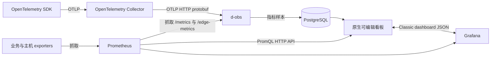

# 可编辑业务看板与主流观测生态

d-obs 的业务看板使用配置定义，支持 OpenTelemetry 落库指标和 Prometheus PromQL。
默认总览与告警、Trace、设备处置继续提供专门的工作流。业务通过标准协议接入数据，
再用模板或面板编辑器定义自己的观察视角。



## 搭建与复用

进入工作台「自定义看板」，新建空看板或从模板创建。初始使用查看模式；点击「编辑看板」
可以添加、编辑、复制、移除与拖拽排序面板。已有旧版看板自动保持原指标定义。
当前看板名称、共享范围、面板数与查询状态显示在顶部；面板的「编辑」直接可用，
复制、存库和删除位于「更多」菜单。半宽面板在桌面占二分之一，窄屏自动单列。

面板可选择 OTLP 指标或 Prometheus；Prometheus 面板保存完整 PromQL，并支持多条查询、
图例 `{{label}}`、即时查询、折线/柱状/大数字/表格、半宽/整行、单位和阈值。
大数字可选择最新值、窗口总和、均值、最小值和最大值；这些计算针对返回的采样点，
计数器的窗口增量应在 PromQL 使用 `increase()`，不能用采样点总和替代。
查询预览使用与正式面板相同的后端适配器。
编辑器先呈现标题、数据源和查询；图表、单位、阈值等进入「展示设置」，库面板进入
「复用库面板」。桌面预览随滚动保持可见，保存、取消与校验提示固定在底部；手机使用
单列布局，保存栏同样保持可见。

变量支持固定选项和文本输入，默认值随看板保存，查看时修改变量会联动全部面板。
「重置筛选」恢复已保存的变量与服务默认值，不修改看板定义。刷新保留当前筛选、
变量输入焦点和已展开的面板菜单；更新中或查询失败时保留的图表明确标为上次结果。
会话失效或访问被拒绝时清除已有看板数据，重新读取授权后才能恢复。
PromQL 使用 `$service` 或 `${service}`，例如：

```promql
sum(rate(http_requests_total{service="$service"}[$__rate_interval]))
```

服务名称取自业务实际标签。变量按单个字面值转义，不支持注入任意表达式。
内置时间变量为 `$__interval`、`$__rate_interval`、`$__range`、`$__range_s`。
OTLP 面板可通过同名的受控标签变量进行筛选；Prometheus 的筛选应写入查询匹配器。

看板默认「仅自己」。原作者可改为「运营团队可查看」，已有平台运营权限的账号可查看、
导出或复制到自己的私有看板；只有原作者可以修改、删除或撤销共享。
这不会扩大租户组员权限，也不提供公开分享。共享范围是平台运营人员。
库面板继续支持复用；新数据源与查询字段随面板保存。
SSO 看板归属使用稳定账号 ID，重名和改名不会改变权限。旧版以账号 ID 或可信邮箱
保存的看板自动迁移；仅以显示名称保存的旧记录保留原数据，需要管理员确认归属后迁移，
不会自动让同名账号认领。

内置模板使用本平台实际输出的指标，覆盖 OTLP 接入健康、指标持久化和边缘设备在线与
数据新鲜度。无数据、缺少 Prometheus 配置或查询失败会明确显示，不能视为健康。

## Prometheus 与 Grafana

后端配置 `RDK_PROMETHEUS_QUERY_URL` 为 Prometheus 的基础 URL，例如同机部署的
`http://127.0.0.1:9090/dobs/prometheus`。查询使用 `/api/v1/query_range` 或
`/api/v1/query`，不接受浏览器指定上游地址。生产抓取与鉴权配置见
[Prometheus 部署说明](../ops/prometheus/README.md) 和
[Grafana 部署说明](./deploy.md)。

Grafana 导入保留完整表达式、多条 target、支持的变量、单位、阈值与面板宽度。
导入的 Prometheus 查询使用平台已配置的数据源；原数据源绑定变化会在兼容报告中提示。
不支持的数据源、转换、多选/All 或动态查询变量等会报告具体原因，避免静默改变指标口径。
兼容范围为 Classic dashboard JSON（含 API 的 `dashboard` 包装及相应 v1 资源包装），
不承诺支持 Grafana v2 动态看板、插件面板或任意布局。

Grafana 导出保留 Prometheus 查询和支持的变量，并提供数据源选择输入。
原生 OTLP 指标与 Prometheus 指标名称、存储路径不同；OTLP 面板会明确报告未导出，
不会被伪装成 Prometheus 查询。完整原生看板请使用「导出模板」。

## 标准 OpenTelemetry Collector

通用配置位于 [ops/otel-collector/d-obs.yaml](../ops/otel-collector/d-obs.yaml)，使用
Collector Contrib 的 OTLP receiver、memory limiter、batch、持久化发送队列和重试，
将 traces、metrics、logs 转发到 d-obs 标准 OTLP/HTTP protobuf 入口。
凭据只从环境变量读取。示例是同机 SDK 接入，receiver 与健康检查绑定回环。

```bash
export D_OBS_OTLP_ENDPOINT='https://<d-obs-host>/<optional-prefix>'
export D_OBS_INGEST_TOKEN='<平台签发的接入凭据>'
export D_OBS_OTEL_STORAGE_DIR='/var/lib/d-obs-otelcol'
mkdir -p "$D_OBS_OTEL_STORAGE_DIR"
otelcol-contrib validate --config=ops/otel-collector/d-obs.yaml
otelcol-contrib --config=ops/otel-collector/d-obs.yaml
```

应用 SDK 使用标准配置，无需 d-obs 专有 SDK：

```bash
export OTEL_SERVICE_NAME='checkout-api'
export OTEL_RESOURCE_ATTRIBUTES='deployment.environment.name=production'
export OTEL_EXPORTER_OTLP_ENDPOINT='http://127.0.0.1:4318'
export OTEL_EXPORTER_OTLP_PROTOCOL='http/protobuf'
```

Collector 负责批处理与缓冲，接收策略、持久化语义和低敏感字段规则仍由平台执行。
需要原生 Prometheus histogram/counter 语义的应用也可直接暴露 Prometheus exporter，
或采用自己的 Collector → Prometheus 管线；原生看板直接执行其 PromQL。
OTLP 三信号、gRPC、鉴权、partial success 与接入自测见 [生态接入说明](./ecosystem.md)。

协议参考：[OpenTelemetry Collector 配置](https://opentelemetry.io/docs/collector/configuration/)、
[Prometheus HTTP API](https://prometheus.io/docs/prometheus/latest/querying/api/)、
[Grafana JSON model](https://grafana.com/docs/grafana/latest/visualizations/dashboards/build-dashboards/view-dashboard-json-model/)。

## 验证

`npm run typecheck` 与 `npm test` 覆盖查询、模板兼容、看板权限和真实组装页面行为。
额外的 PostgreSQL 集成测试使用独立测试数据库，验证旧表迁移、共享只读、完整查询保存，
以及真实标准 OTLP HTTP 上报 → 落库 → 看板查询链路：

```bash
DOBS_TEST_DATABASE_URL='postgresql://<test-user>@127.0.0.1:<test-port>/<test-db>' \
  node --import tsx --test server/monitoring/dashboard-boards-pg.integration.test.ts
```

该测试需允许创建临时数据库；不要指向生产数据库。
