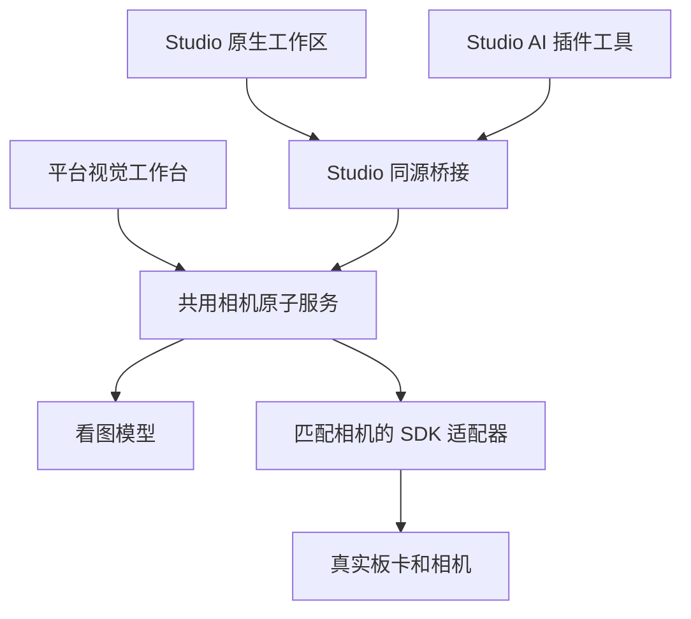

# RDK 视觉调试平台能力说明

文档更新：**2026-10-14**；最近实机验证：**2026-10-13**。

视觉调试平台用于把相机接入、实际采图、参数实验、AI 调试、效果判断和成果交付放到同一个流程里。工程师可以在网页手动操作，也可以在 RDK Studio 内让 AI 调用同一组原子工具。按实际产生的证据保存参数版本、回读、图像与运行记录，便于比较、恢复和复现。

能力口径更新至 **2026-10-14**；下文 S100 实机证据来自 2026-10-13。当前已在 **S100 加 USB UVC 相机** 上验证视频帧、控参、AI 看图调试、恢复和导出流程，并接通本机新版 Studio 源码运行版。X5 原生 v2 已有 SDK 模块、RAW 回灌和离线标定的软件实现，仍待匹配 SDK 编译部署及 MIPI 实机验收；当前实拍没有得到可靠画质改善，不能把流程完成写成画质达标。

## 2026-10-14 易用性更新与范围

平台网页新增接入检查与下一步提示，新建时自动填入已登记相机信息；AI 启用条件与执行器共用完整原子能力列表。结果先给目标、最终参数、终态新图和 AI 退化观察，完整历史按需展开。恢复失败优先于旧成功回执；人工成功恢复重新采图，并清除旧恢复错误。本次发布将网页流程、受保护插件下载和恢复准入一起交付；Studio 桌面安装包的更新仍需单独构建与发布。

当前“点亮”启动已有驱动和采集模式。根据两套硬件说明书生成新驱动、设备树并自动编译部署仍未实现。X5 v2 的模块、RAW 回灌和离线标定代码及软件验证见 [原生能力说明](vision-workshop-x5-native.md)；下文 2026-10-13 的 USB/Studio 实机记录不覆盖 X5。

## 平台可以完成的工作

| 能力 | 可以做什么 | 当前支持范围 |
| --- | --- | --- |
| 相机接入知识 | 按板型、Sensor 和关键词查找接线、系统、SDK 条件、调试步骤与来源，查看当前能力缺口。 | 已有 X5 与亚博 IMX415 的审定资料；资料核对不代表设备已点亮。 |
| 实验与设备绑定 | 创建实验，记录目标、场景、板卡、相机、SDK、接口和工作模式，绑定已登记适配器。 | 平台已实现；同一实验的图像、参数和操作保持关联。 |
| 设备能力检查 | 探测相机、检查媒体链路、调用已适配的初始化或点亮流程，展示真实事实与失败回执。 | S100 现有 UVC 驱动出图已实测；新型号驱动和初始化仍需适配。 |
| 实际画面预览 | 启停相机预览，读取真实 PNG 或 JPEG 帧，查看采集模式和设备状态。 | 已实现并实测 USB 采集；显示刷新速度不等于相机标称采集帧率。 |
| 参数读取与设置 | 读取曝光、增益、亮度、对比度、饱和度、Gamma、锐度、白平衡及自动模式等，设置后核对实际值。 | 具体字段、范围、步长与可写状态以设备回读为准；自动模式下失活的手动参数不能直接调整。 |
| 场景采图与留样 | 保存当前实际视频帧、场景、时间、控制快照、参数版本和文件哈希。 | 已实测；视频 PNG、JPEG 和 YUYV 不属于 Bayer RAW。 |
| AI 看图自主调试 | 输入自然语言目标，让模型观察实际画面，决定调整、保留、恢复或停止，并解释依据。 | 已有真实模型与设备闭环；模型判断仍需工程验收。 |
| AI 参数候选 | 根据 RAW 或视频帧统计、现有基础参数和允许的数值规则生成候选，显示修改项和理由。 | 已实现；生成候选不会自动应用，候选受已有参数路径、范围和步长约束。 |
| 参数版本与恢复 | 保存原始配置、基线历史、候选与实际回读，恢复已保存版本，核对应用与回读哈希。 | 已实测 UVC 完整控制配置；配置格式由设备适配器决定。 |
| 图像观察与评价 | 并排查看图像、局部放大，记录工程师的 1–5 分、说明和剩余问题，继续下一轮实验。 | 人工评价与 AI 判断分别保存；AI 不替工程师填写评分。 |
| 客观图像统计 | 对支持的 PNG 计算亮度均值、空间标准差、近黑近白比例、RGB 均值和局部区域变化。 | 同一 RAW 的匹配输出可保存前后比较；这些统计不是校准噪声、色差、MTF 或综合画质分。 |
| 成果导出 | 下载实验 ZIP、参数快照、实际图像、版本清单、运行报告和操作手册。 | 已实际下载并核对；可选包含真实 RAW，当前 USB 实验没有 RAW 文件。 |

## AI 原生调试如何工作

参与者先描述希望改善的效果，不需要先手填 tuning JSON 或预设曝光试探序列。开始前必须有可用的相机适配器、实际采图、控制回读、完整恢复能力和模型服务。

1. **保存本轮原始状态。** 读取完整控制配置，重新采集现场画面，保存可恢复快照。
2. **让模型看实际图像。** 模型同时获得原始、当前和最佳画面，以及控制范围、实际值、设备信息和历史动作。
3. **由模型选择下一步。** 模型决定调整、保留、恢复或停止；每次最多改变 3 个支持字段，单次运行最多 6 次实际调整，可以提前结束。
4. **执行后重新验证。** 平台核对真实控制回读，重新采图，记录请求值与实际值，以及模型对噪点、细节、颜色和曝光的观察与有限图像统计。
5. **保留结果或恢复。** 模型判定存在可用改善、未声明退化且参数回读一致时，可保留对应版本供工程师复核；没有这样的候选时恢复原始参数。取消或失败会尝试恢复，恢复失败会明确显示。
6. **保存运行和交付成果。** 记录模型来源、每轮决定、图片、配置哈希、停止原因和最终状态，供后续复盘与下载。

点击停止后要等恢复回执完成，停止请求本身不代表已经恢复。AI 自主运行的内部恢复会尝试保存恢复后新帧；人工“恢复运行前参数”也会重新采图；若采图失败，明确显示参数回读已确认、画面尚未确认。

平台保留两种不同的 AI 入口：

| 入口 | 模型获得的输入 | 用途 |
| --- | --- | --- |
| AI 看图自主调试 | 实际原始、最佳、当前图像，控制信息与历史。 | 模型自主决定下一步，由平台执行原子操作并验证。 |
| AI 参数候选 | RAW 或视频帧统计、基础参数与数值规则。 | 给工程师提供受限候选，供后续应用和评价；该入口不等于模型直接理解 Bayer 文件。 |

AI 可以辅助发现反光、模糊、噪点或颜色问题，但角度、照明、光学焦点等问题可能需要现场调整。模型认为“改善”或任务显示“完成”，都不等于人工画质验收通过。

## RAW 与 ISP 可以做到哪一步

RAW 指相机感光芯片输出的 Bayer 原始数据。ISP 是把这些原始数据处理成可用图像的图像处理链路。平台已提供数据、参数和执行编排，但实际采集、处理与板端生效必须由匹配的相机驱动和厂商 SDK 完成。

| 工作 | 平台已有能力 | 真正执行所需条件 |
| --- | --- | --- |
| 导入真实 RAW | 校验场景、尺寸、位深、Bayer 排列、打包方式、行跨度、曝光与增益等元数据；解包、统计、输入预览和下载。 | 手头有真实 RAW 及正确元数据。当前支持 unpacked16le、MIPI RAW10、MIPI RAW12 等声明格式；输入预览不是 ISP 输出。 |
| 多场景 RAW 实采 | 按场景归档 SDK 输出的原始字节与元数据，校验文件哈希。 | 设备与适配器实际实现 capture_raw；当前 USB 相机不提供。 |
| 用参数处理 RAW | 将同一 RAW 分别交给基础和候选参数处理，保存实际结果图，用于受控比较。 | 厂商 SDK 支持 RAW 回灌与 process_raw，能够产生实际 PNG 或 JPEG；当前 S100 USB 链路未接通。 |
| 应用与恢复 ISP 参数 | 记录确切版本，调用 SDK 加载、回读和恢复，保留应用证据。 | 对应 SDK 格式与加载接口已适配；平台通用 JSON 候选不能直接等同于厂商完整 ISP 文件。 |

有 RAW 和真实基础参数时，可以先完成样本入库与候选生成；得到真实 ISP 处理图和板端生效结果仍需要 SDK。也可以导入外部处理图做评价，但外部图像不证明平台已把参数应用到板端。

X5 原生 v2 提供类型化 SDK 模块、效果库加载/导出、真实 RAW 回灌的软件实现，以及 BLC、LSC、CCM、AWB 的离线 CPU 标定任务。计算完成、SDK 应用回读和实际画质验收分别记录；校准 SNR、MTF、色差等自动验收仍未提供。

## 在 Studio 内如何使用

新版 Studio 的入口为 **AI → 扩展中心 → RDK Camera Workshop → 打开相机插件工作区**，设备上下文面板也可以进入。无需先选中 Studio 的 SSH 设备，但平台必须已经登记并连接实际相机适配器。

原生工作区提供实验选择与新建、自然语言目标、2／4／6 次调整上限、后台进度、停止恢复、人工恢复、图像证据、模型解释、参数回读和 ZIP 下载。关闭工作区后重新打开可以找回后台任务与已保存记录。已结束运行在 Studio 宿主重启后找回已经实测。相机调试执行服务重启后，未结束任务当前不会自动续跑；读取时标记为中断，恢复状态未确认，需要核对实际设备状态后人工恢复或重新发起。

当前插件包含 **1 个产品技能**；工具清单以宿主 MCP discovery 为准，已补实验就绪查询、效果库、标定任务与部署应用工具。2026-10-13 实机记录覆盖当时的 25 个工具。Studio AI 可以发现能力、读取知识、启动调试和查询实际结果，设备写入沿用 Studio 的工具权限。原生界面主要覆盖 AI 调试；预览会话、手动控参、RAW 与 ISP 可通过相应工具调用，本次补充接入、点亮、采集、ISP、标定、交付的步骤入口，按所选设备实际支持操作开放。



平台网页、Studio 界面与 AI 工具使用同一实验和执行服务。安装插件不会自动安装新相机驱动或生成新的硬件适配器。

当前 Studio 接入已在独占本机运行环境验证，多账号云端桥接尚不可用。插件 ZIP 要求宿主已包含原生工具装配、桥接和工作区界面，导入 ZIP 不会升级旧版已安装客户端；桌面安装包更新与生产发布尚未完成。

## 可以交给平台的典型任务

**已有 USB 相机，想核实画面和可调参数。** 可以检查设备、启动预览、读取真实控制、保存画面，手动调整后回读，也可以让 AI 尝试少量可逆调整。

例如：“先核对这台相机支持哪些参数。在保留屏幕文字和线缆边缘的前提下改善反光，最多调整两次；没有可靠改善就恢复。”

**已有真实 RAW 和基础 ISP 参数，想比较方案。** 可以导入样本、记录场景、生成有限参数候选，并在已接入 SDK 后用同一 RAW 处理基础与候选方案，查看局部细节、统计和人工评价，再选择交付版本。

例如：“读取这组逆光场景样本与基础参数，生成受支持范围内的候选。用同一 RAW 比较输出，记录高光、颜色和细节的变化。”

**准备接入新的 MIPI 相机。** 可以先检索已入库资料、核对系统与 SDK 条件、列出缺少的原子操作。相机型号不在当前适配器中时，需要实现和验证驱动、采集及 SDK 操作，再进入真实点亮、RAW 和 ISP 流程。

对 DDC 工作坊，当前 S100 USB 可以承载“预览与控参 → 实拍 AI 调试 → 参数恢复 → 实验导出”的流程。完整“多场景 RAW → 原生 ISP → 专业画质验收”需要补齐匹配的 MIPI 相机与 SDK 链路。

## 实验成果保存了什么

每个实验把设备上下文、基础配置、候选版本、视频帧、RAW、ISP 输出、人工评价、图像比较和设备执行记录关联起来。实际存在的文件才会进入成果包，尚未采集的 RAW 或尚未选定的交付参数不会被补成示例结果。

成果 ZIP 可包含：

- **版本清单。** 实验目标、板卡与相机、SDK、接口与模式、参数和图像哈希、设备执行记录。
- **数据与图像。** 实际视频帧、ISP 处理图，以及按需包含的真实 RAW。
- **参数与运行报告。** 选定的候选参数；AI 运行的原始与最佳配置、模型决定、实际回读、停止原因和恢复状态。
- **操作手册。** 实验步骤、来源、版本、评价、已知限制和复现或恢复所需条件。

当前 USB 输出的 uvc-controls-v1 是相机控制配置，不能作为 MIPI ISP 全模块 tuning 文件使用。AI 最佳配置属于模型推荐历史，工程师仍需根据实际画面和项目验收标准决定是否采用。

## 当前实测结论

| 项目 | 2026-10-13 的实测结果 |
| --- | --- |
| 实际硬件 | RDK S100，Integrated_Webcam_HD，USB UVC；本次使用 640×480 MJPG、25 fps 采集模式。 |
| 相机基础闭环 | 真实预览、控制读取与写入、重新采图、参数回读、版本保存、导出和恢复已验证。 |
| Studio AI 调试 | 正常运行发生 1 次真实调整和 2 次视觉判断，未找到可靠改善，恢复原始配置。 |
| Studio 新建与停止 | 新建实验后，在原始快照保存完成、首次控参写入前真实取消；取消终态与恢复配置哈希一致。 |
| 历史与成果 | 已结束运行与图片在宿主重启后可找回；实际下载 ZIP 并核对参数快照哈希。 |
| 画质 | 仍有眩光与模糊，目标未达成，没有完整画质验收通过结论。 |
| RAW 与板端 ISP | 当前 USB 适配器不提供 Bayer RAW，也没有接通原生 SoC ISP 调优。 |
| 尚未覆盖的异常实测 | 写入过程中取消与硬件故障注入尚未实机验收；执行服务重启后的自动续跑当前未实现。 |

这些结果证明当前 USB 调试流程可以运行，并且会保留失败或无改善结果。后续接入其他相机时，应重新核对同一适配器的采图、控参、RAW、处理、应用与恢复能力，再做该设备的验收。

## 原子工具分组

Studio 工具名统一加 mcp__rdk-camera-workshop__ 前缀。下表按工作分组概括能力，2026-10-13 的 25 个工具名称见“接口调用与完整工具名称”；新增名称见文末本次更新。

| 分组 | 数量 | 工作内容 |
| --- | --- | --- |
| 相机知识 | 2 | 检索和读取接入知识。 |
| 能力发现与通用执行 | 2 | 发现能力，调用已注册操作。 |
| AI 自主调试 | 4 | 启动、查询、取消、恢复原始配置。 |
| 相机接入、预览与控参 | 9 | 探测、链路检查、点亮、预览、控参和视频留样。 |
| RAW 与 ISP | 5 | RAW 实采、候选生成、处理、应用和恢复。 |
| 图像评价与比较 | 2 | 记录人工评价，保存受控图像比较。 |
| 成果导出 | 1 | 下载真实实验成果。 |

工具目录存在不代表当前设备支持全部操作。执行前必须读取当前能力和所选适配器的操作列表。REST、MCP 与 UI 都依据同一实际契约和回执判断结果。

## 操作与工程接入说明

### 平台网页和 Studio 的功能覆盖

| 工作 | 平台网页 | Studio 原生工作区与 Agent |
| --- | --- | --- |
| 知识检索与能力核对 | 知识折叠区、设备能力与来源。 | 工作区显示实际适配器；详细知识由 Agent 工具读取。 |
| 实验创建与历史 | 可建设备实验，也可建不绑定设备的数据导入实验。 | 工作区选择或新建已登记相机实验，找回运行记录。 |
| 探测与点亮 | 手动探测、链路检查和点亮入口。 | AI 运行会探测；独立点亮操作由工具调用。 |
| 预览与手动控参 | 预览刷新、参数表单和实际回读。 | 工作区展示运行帧及请求与回读；预览会话和手动设置由工具调用。 |
| AI 自主调试 | 自然语言目标、调整上限、运行状态与证据。 | 原生工作区及 Agent 均支持。 |
| RAW 与 ISP | 导入、场景、候选、处理与应用步骤按能力开放。 | 通过工具执行；当前没有独立 RAW 或完整 ISP 面板。 |
| 人工评价与受控比较 | 评分、同 RAW 比较、ROI 与放大。 | Agent 可记录工程师提供的评价；工作区展示 AI 判断，不代填人工评分。 |
| 恢复与交付 | 参数版本恢复、候选选择、tuning 与 ZIP。 | 工作区恢复本次原始参数并下载 ZIP；其他交付操作走工具。 |

各入口共用执行服务。界面有按钮或目录里有工具，不代表所选硬件已经支持该操作。

### 开始前的准备

数据导入实验需要真实样本、准确元数据、实际基础参数和允许调整的数值规则，可以不绑定在线设备。真实设备实验必须选择服务端返回的 targetId，并匹配板卡、相机、SDK、接口和工作模式；创建实验本身不会连接硬件。

自主调试要求同一个适配器具备 probe、controls_get、controls_set、capture_frame、restore_tuning，并且看图模型已启用。当前闭环还要求实际采集并归档可校验哈希的 PNG；通用预览支持 JPEG 不代表它能够直接进入这条调试路径。全局 aiDebug 显示 available 后，仍须核对所选适配器并实际探测。设备被占用时会拒绝新执行，当前没有等待设备释放的持久任务队列。

已有未绑定设备的实验没有修改绑定接口。换相机、模式或需要从导入实验转为在线设备实验时，应新建正确绑定的实验。

### 实际操作步骤

**在 Studio 做一次 AI 调试**

1. 打开相机插件工作区，核对适配器身份和支持状态，选择或新建实验。
2. 写清要改善的问题、必须保留的细节与允许的调整次数。先使用 2 次上限核实效果。
3. 启动后查看实际画面、模型决定、请求值和实际回读；页面关闭不等于任务停止。
4. 没有可用改善时查看原始恢复回执。需要停止时等待取消终态及恢复结果；图像采集失败与参数恢复失败分别处理。
5. 结束后下载成果，检查原始、最佳和最终设备状态，并保留目标未达成的结论。

**在平台手动调整 UVC 参数**

1. 探测设备，检查链路和出图，读取完整控制状态并保存原始配置。
2. 按设备实际类型、范围、步长、writable 和 active 状态设置。手动曝光失活时，先关闭自动曝光并回读；白平衡同理。失活的保存数值不代表自动模式当前生效值。
3. 改变控制或自动模式后，重新读取实际配置并保存当前基线，再留样或生成候选，避免把旧基线帧混入新版本。
4. 应用候选后核对完整配置与回读哈希，再采集新帧；绑定候选的帧必须对应实际参数版本。
5. 评价效果后恢复完整保存配置或指定历史版本，并再次读取实际状态。

**完成同一 RAW 的参数比较**

导入或实采真实 RAW → 保存匹配的基础配置和规则 → 生成候选 → 用 SDK 分别处理基础与候选 → 比较同一 RAW 的匹配 PNG → 记录工程师评价 → 选择交付版本 → 在设备应用、回读并导出。

其中 SDK 未接通时，可以做数据整理与候选生成，但不能把外部处理图写成板端参数已生效。

### 接入新相机需要交付什么

| 材料或实现 | 必须确认的内容 |
| --- | --- |
| 设备与版本 | 板型、Sensor、接口、模式、系统与 SDK 版本；资料条件和实机状态分别记录。 |
| 驱动与初始化 | 真实驱动、接线、初始化及媒体链路检查。规格资料不能直接替代可运行驱动。 |
| 适配器与执行器 | 只登记已经实现的操作；执行器调用固定 SDK 程序，返回真实事实、文件和失败状态。 |
| 图像格式 | 实际 RAW 的位深、Bayer、packing、stride 和黑白电平；新布局需新增解包实现或由 SDK 导出已支持格式。 |
| 参数与恢复 | 真实基础参数、可调路径及范围、厂商格式处理、加载与回读接口、完整原始版本恢复。 |
| 实机验收 | 按顺序核对点亮、视频帧、RAW、处理、应用、回读、恢复和画质，不把其中一项成功扩展成全部完成。 |

X5 与亚博 IMX415 目前有接入知识，仍需对应原生执行适配器及实机验证。调焦、照明和 IR-CUT 等操作是否可自动控制，也要看实际硬件与接口。

### 运行状态和异常处理

| 状态 | 应如何理解 |
| --- | --- |
| queued | 运行已保存，等待当前进程启动后台执行的短暂状态；已取得设备锁，不是持久排队系统。 |
| running | 正在读取原始状态、调用模型、调整、采图或完成最终恢复。 |
| completed | 有界调试正常结束；可能没有改善、目标未达成或需要现场调整。 |
| failed | 执行失败；有原始快照时尝试恢复，须查看错误及实际恢复结果。 |
| canceled | 取消请求已被执行流程处理；仍需核对 final 与 restorationError，不能只看状态判断恢复成功。 |
| interrupted | 保存记录有未结束任务，但当前执行进程没有对应活动任务；不会自动续跑，恢复状态未确认。 |

| 问题 | 处理方式 |
| --- | --- |
| 无适配器或缺操作 | 核对同一相机 profile 和 SDK 实现，不借用其他设备的能力或模拟结果。 |
| 设备占用、模型忙 | 等待当前操作结束后查询；设备锁冲突不会自动排队。 |
| 控制失活或数值越界 | 重新读取描述符，确认自动模式，再按实际范围与步长设置。 |
| 基线变更、没有匹配帧 | 核对基线历史，按当前配置重新留样后生成候选。 |
| 回读不符、超时或断连 | 写入可能已经发生，先查 deviceRuns 和实际 controls；结果未确认时不盲目重试。 |
| 恢复失败或没有终态图 | 分别核对配置恢复错误和采图错误；旧历史推荐图不能替代当前设备状态。 |
| RAW 或比较格式不符 | 从实际 SDK 核对文件布局，使用同 RAW、同尺寸且参数版本匹配的输出图。 |
| 文件过大或额度不足 | 先保存已有成果，再减少输入或安排受控数据维护；当前没有页面调额或实验删除入口。 |

### 数据格式与资源边界

RAW 必填元数据为 scene、width、height、bitDepth、bayer、packing、stride、blackLevel、whiteLevel；exposureUs 与 gain 可选。文件代表单帧，实际长度必须正好等于 stride × height。RAW10 要求 10 位且宽度是 4 的倍数；RAW12 要求 12 位。unpacked16le 每像素占两个字节，不能把普通视频字节按名称改成 RAW。

同 RAW 客观比较要求同一实验、同一 sampleId、同尺寸，以及基础和候选图的参数哈希分别匹配对应版本。当前支持 8 位、非交错、非索引色、非动画且完全不透明的 PNG；JPEG 可展示和人工评价，不能直接用于这项客观比较。ROI 必须完整位于图内。两次独立视频采图可以观察变化，但不是同 RAW 的受控输入。

| 项目 | 当前边界 |
| --- | --- |
| 平台单个 RAW 与图像 | 默认上限分别为 64 MiB、16 MiB。 |
| 实验与总存储 | 默认单实验 128 MiB、全局 12.5 GiB；包括资产与元数据。 |
| 实验数 | 默认全局 100 个，跨账号共享总量，不是每账号 100 个。 |
| Studio 二进制入口 | 当前上限 32 MiB，不能把平台 RAW 上限直接套到所有入口。 |
| 看图模型输入 | 当前单张输入上限 1 MiB；可归档较大图像不代表可以原样送入看图模型。 |
| AI 运行 | 调整参数可选 1–6 次，默认 4 次；每次最多 3 个控制键，运行预算 10 分钟。 |
| SDK 操作 | 执行器默认超时 110 秒、上限 120 秒；具体还受实际适配器与入口限制。 |

服务构造参数可以下调部分存储限额；当前默认路由未提供活动账号在页面自由调整额度的能力。执行前以 capabilities.limits、实际格式及当前入口为准。

### 候选选择与导出的条件

人工选定候选需要该候选已有实际结果图或视频帧，并且关联图像有工程师评价。平台网页的可选列表还按当前基线筛选；历史候选可以显式指定 candidateId 下载。当前没有最低评分或专业画质自动达标门槛，因此“已选定”不是验收通过。

指定 candidateId 可以下载存在的候选 tuning，用于后续实验；不指定时下载已选候选。导出实验 ZIP 不要求已经选定候选或画质达标；没有选定候选时不生成 candidate_tuning.json，AI 运行则保存自己的原始与最佳配置和报告。RAW 默认不打包，includeRaw=1 才包含实验里实际存在的 RAW。

### 接口调用与完整工具名称

| 调用入口 | REST 前缀 | MCP endpoint |
| --- | --- | --- |
| 平台 | /api/ops/observability/vision-workshop | /api/ops/vision-workshop/mcp |
| Studio 同源桥 | /api/vision-workshop | /api/vision-workshop/mcp |

通用 execute 的 operationId 是能力目录返回的“方法加注册模板”，例如 GET /api/vision-workshop/experiments/:id。Studio 会归一化为平台注册操作。operationId 不包含域名或反向代理基路径；身份由已授权会话或宿主提供，不能塞进工具参数。

例如，向 Studio 的 MCP endpoint 查询已存在实验：

```json
{
  "jsonrpc": "2.0",
  "id": 1,
  "method": "tools/call",
  "params": {
    "name": "vision_workshop_execute",
    "arguments": {
      "operationId": "GET /api/vision-workshop/experiments/:id",
      "params": { "id": "EXPERIMENT_ID" }
    }
  }
}
```

启动同一实验的两次调整预算：

```json
{
  "jsonrpc": "2.0",
  "id": 2,
  "method": "tools/call",
  "params": {
    "name": "vision_ai_debug_start",
    "arguments": {
      "experimentId": "EXPERIMENT_ID",
      "goal": "改善局部反光，保留文字和边缘；没有可用改善就恢复。",
      "maxRounds": 2
    }
  }
}
```

EXPERIMENT_ID 必须替换为当前身份已有的实际实验 ID。JSON-RPC 的工具名用基础名；Studio 宿主向 Agent 暴露时统一加 mcp__rdk-camera-workshop__ 前缀。写请求继续遵守相应入口的会话、权限和请求保护，不绕过确认边界。

以下为 2026-10-13 实机阶段的 25 个工具基础名称（历史清单；当前新增能力见文末）：

```text
vision_camera_knowledge_search
vision_camera_knowledge_get
vision_workshop_capabilities
vision_workshop_execute
vision_ai_debug_start
vision_ai_debug_status
vision_ai_debug_cancel
vision_ai_debug_restore_original
vision_camera_probe
vision_pipeline_validate
vision_camera_bringup
vision_camera_preview_start
vision_camera_preview_stop
vision_camera_preview_frame
vision_camera_controls_get
vision_camera_controls_set
vision_camera_capture_frame
vision_raw_capture
vision_isp_generate
vision_isp_process_raw
vision_isp_apply
vision_isp_restore
vision_image_evaluate
vision_image_compare
vision_workshop_export
```

## DDC 相机工作坊交付范围

| 原功能清单 | 当前完成度 | 完整交付仍需补齐 |
| --- | --- | --- |
| 相机驱动适配与点亮 | 接入知识和统一操作契约已有，S100 现有 UVC 出图已实测。 | 指定 Sensor 的驱动、初始化、SDK 适配与实机验收。 |
| 画面预览与曝光控制 | UVC 预览、设置、回读已实测。 | 目标相机字段验证；Studio 独立手动控制面板。 |
| 多场景 RAW 原图采集 | 导入、元数据、场景归档与 SDK 实采契约已有。 | 接通并验证目标设备 capture_raw，当前 USB 不提供。 |
| AI 生成画质调优参数 | 视频控参自主调试和受限统计候选已有。 | 匹配厂商完整 ISP 格式、模块范围和真实输出验证。 |
| 应用参数与前后对比 | UVC 应用、恢复、图像观察与回读已有。 | 同 RAW 的 SDK 基础与候选处理、板端原生 ISP 生效。 |
| 画质评估与反复调整 | AI 观察、人工评价、ROI 统计和多轮记录已有。 | 项目画质标准与专业验收；本次现场目标尚未达成。 |
| 导出调优成果 | 实验 ZIP、配置快照、图片、报告和手册已下载核对。 | 原生 ISP 交付文件必须来自匹配 SDK 与确切版本。 |

当前硬件可以用于 USB 相机与 AI 调试工作坊，交付实验记录、控制配置、真实图像与操作手册。若活动主题是原生 ISP 调优，应先把 MIPI 相机、RAW 采集和对应 SDK 链路跑通，再安排完整流程。

验收时分别核对四项：**操作是否完成、参数是否真实生效、画质是否达到项目标准、成果是否可以复现**。前两项有回执不代表第三项通过；导出包应保留未达标、已恢复和待验证状态。

建议每组离场时至少保留设备与版本信息、原始可恢复配置、本次运行报告、实际图像、采用或未采用候选的依据，以及重新使用和恢复步骤。场景角度、照明、对焦等现场条件应写入实验说明，不能用预置示例代替本组实际成果。

多小组活动还需配置参与身份、组与设备分配和资源安排。当前视觉模块的实验绑定不包含扫码分组；targetId 用于适配器匹配与执行定位，不代表分组授权或长期独占，请求和运行互斥也不代替组与设备分配。Studio 相机桥尚不支持多账号云端共用。


## 实现与验收依据

能力清单对应 d-obs 的 docs/vision-workshop-atomics.md、server/monitoring/vision-workshop-*、tools/vision-workshop-device-runner.mjs 与 tools/vision-uvc-camera.py。

Studio 接入对应 rdstudio-web-master 的 plugins/rdk-camera-workshop、server/vision-workshop 和 src/components/vision-workshop。实测依据为 d-obs 的 .codex/artifacts/s100-camera-20261013、s100-ai-native-20261013 与 studio-camera-plugin-20261013 中保存的验收记录；取消能力以较新的 Studio 验收范围为准。

当前文档描述代码能力与本机实测范围，正式活动交付还应核对当次相机、适配器、模型服务和实际运行版本。


## 2026-10-14：从接入到 ISP 的步骤与新增原子能力

网页以接入、点亮、采集、ISP、标定、交付六步组织操作。实验就绪接口只读取本身份保存的资料和回执，显示缺少的操作、恢复阻塞和证据来源；不会发起设备探测，历史成功也不表示现在在线。恢复失败或重启中断后的原始状态未确认时，新 AI 调试被拒绝，必须显式恢复并核对实际回读。

ISP 入口支持读取当前参数、保存恢复基线、加载有哈希的 SDK 效果库 JSON、核对独立回读与导出。标定入口支持导入已记录采集条件的暗场、平场、灰卡或线性 RGB 色卡数据，创建并执行 BLC、LSC、AWB、CCM CPU 任务，查看失败原因与结果，先生成应用计划再按可信 SDK 映射应用。`computed` 仅代表算法完成；没有合格素材、SDK 字段映射或真机回读时，界面保持待补条件。

新增工具基础名称：

- `vision_camera_readiness`
- `vision_workshop_runtime_status`、`vision_experiment_list`、`vision_experiment_create`、`vision_experiment_get`、`vision_tuning_baseline_import`
- `vision_isp_tuning_get`、`vision_isp_tuning_load`、`vision_isp_tuning_export`
- `vision_calibration_asset_import`、`vision_calibration_asset_list`
- `vision_calibration_task_create`、`vision_calibration_task_list`、`vision_calibration_task_get`、`vision_calibration_task_run`、`vision_calibration_task_result`
- `vision_calibration_apply_plan`、`vision_calibration_apply`

插件下载提供两类包：平台完整包带技能、MCP 转接、设备工具与原生源码；Studio 包依赖已有兼容的本地/桌面 Studio 宿主。均从登录后的相机工作台取得受保护下载地址并核对 SHA-256。安装插件不会自动建立 SSH 连接、注册设备或让云端 Studio 访问本机板卡。

新 Sensor 从规格书生成驱动、设备树并自动编译部署仍未完成。现有 `bringup` 启动已适配驱动和模式。当前 S100 USB 的视频控制验证不覆盖 Bayer RAW、X5 原生 ISP 或 MIPI 相机质量验收。
